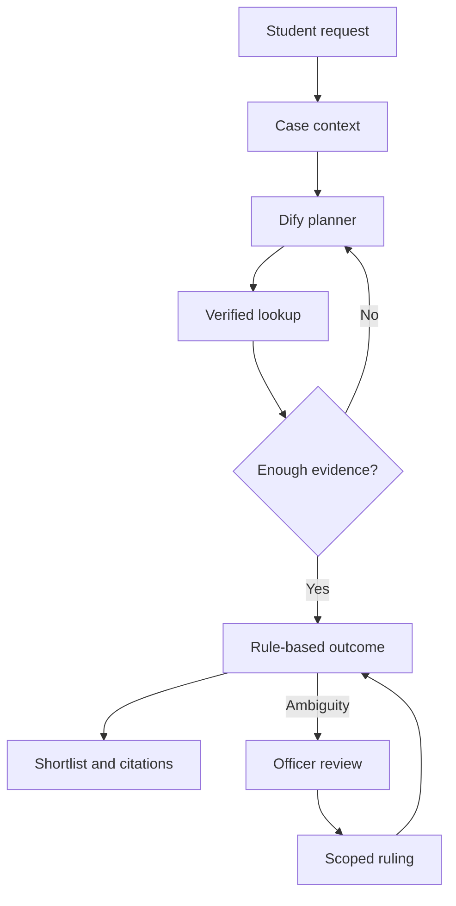

# Architecture and operating boundaries

The prototype helps a student decide what to do next. It reconstructs the applicable notice, checks verified facts and escalates ambiguous requirements. The placement office resolves a disputed fact within the current demonstration session. The campus remains the authority for official processes and application submissions.

## Evidence flow

- **Streamlit** renders the student shortlist, current and superseded notices, lookup trail, office inbox and benchmark.
- **Dify** is the optional live planner. It decides which allowlisted read to request after each observation. The workflow uses synthetic fixture records and a bounded number of rounds. The planner does not write records, declare eligibility or impersonate an officer.
- **Python evidence checks** enforce effective notices, access to a case profile, hard requirements, deadlines and valid course rulings. Unsupported or conflicting evidence results in a hold or request. The server independently reconstructs the authoritative record from a live response's trace.
- **Officer review** accepts a scoped equivalence decision, records lack of equivalence, or requests more evidence. A confirmation rechecks remaining criteria. The session isolates demo runs and is not institutional identity or a shared placement system.
- **Offline mode** uses deterministic controllers and the same underlying rules and case fixtures. The standalone browser storyboard replays actual precomputed synthetic snapshots. Neither measures model quality.

## Dify boundary

The app uses the published workflow through its Service API. A real Dify run requires a workflow app key and a model in the selected Dify workspace. The API key is a server-side setting. The local demo and fallback do not require it. See `workflow/README.md` for setup, workflow import and verification.

## Failure and review cases

| Situation | Behavior |
|---|---|
| An amendment raises a minimum | The governing version drives the recommendation. The old version remains visible as history. |
| Governing evidence conflicts | Hold the case for review. A contradictory record cannot produce a ready decision. |
| A requisite profile fact is absent | Ask for the missing fact and identify the associated requirement. |
| A capstone equivalence is ambiguous | The reviewer sees the exact criterion and relevant evidence. Approved equivalence rechecks all other requirements. |
| API or model produces an error | Show the error and which mode was selected. The presenter can explicitly switch to local simulation. |

## Production changes that would be required

Use approved SSO and assigned officer roles, campus-level access isolation, durable audit records, and authorised notice ingestion. Agree on what the model provider can receive and how long it can retain the data. Keep source versions and review authority traceable. Evaluate on redacted cases before a shadow pilot. See `business-evidence.md` for the scope and official sources.
